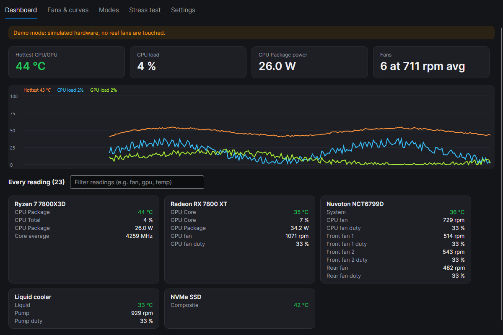
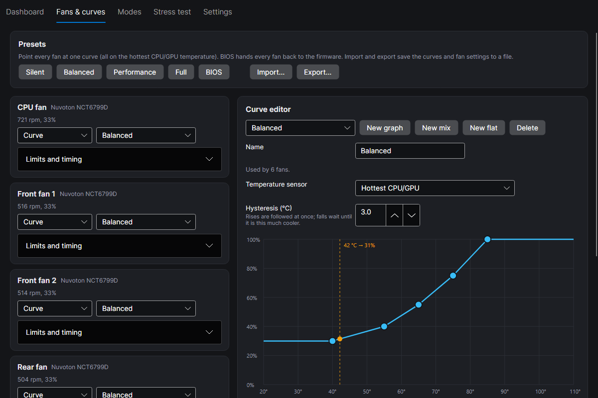
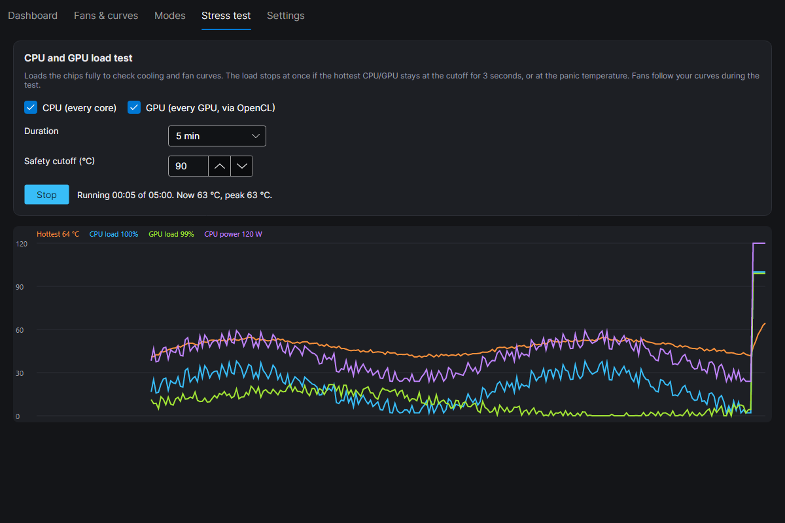
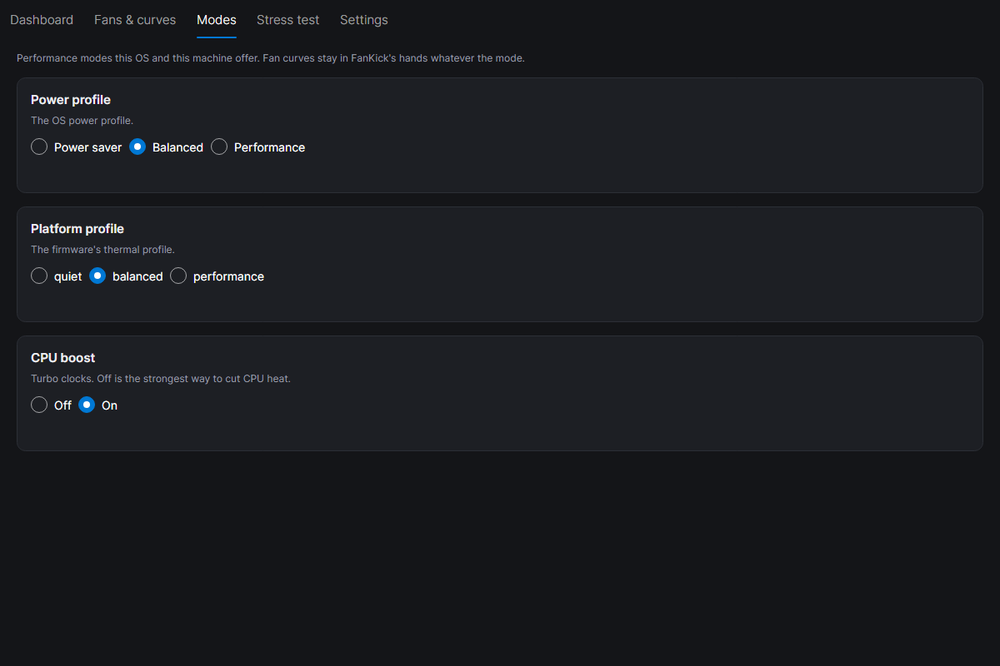
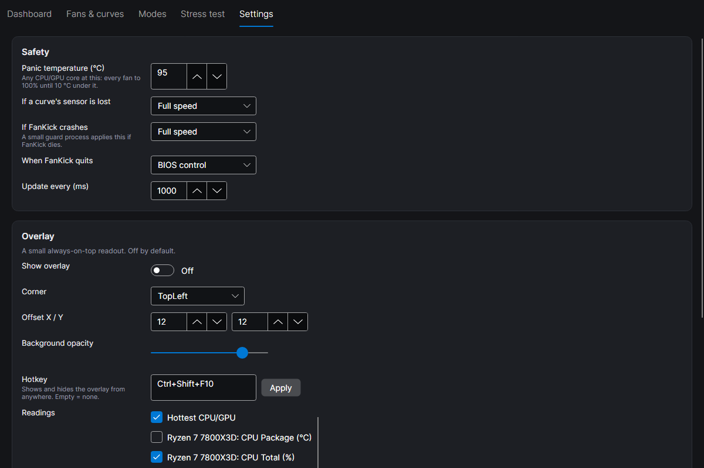

<p align="center"></p>

<h1 align="center">FanKick</h1>

<p align="center">Free, open source fan and thermal control for Windows, macOS and Linux.<br>
Every fan and every sensor on your machine, a real curve editor, performance modes, a stress test and an optional overlay.</p>



FanKick started as a fix for one overheating laptop whose fan controller couldn't read its own CPU temperature. It
now drives fans on any desktop or laptop it can reach, and it is built to fail safe: if anything goes wrong, fans go
to full speed or back to the BIOS. They are never left stuck.

## Download

| System | Installer | Portable |
|---|---|---|
| Windows 10/11, Intel/AMD (x64) | [FanKick-Setup-win-x64.exe](https://github.com/harshaldevvv/fankick/releases/latest/download/FanKick-Setup-win-x64.exe) | [zip](https://github.com/harshaldevvv/fankick/releases/latest/download/FanKick-win-x64.zip) |
| Windows 11 on ARM (ARM64) | [FanKick-Setup-win-arm64.exe](https://github.com/harshaldevvv/fankick/releases/latest/download/FanKick-Setup-win-arm64.exe) | [zip](https://github.com/harshaldevvv/fankick/releases/latest/download/FanKick-win-arm64.zip) |
| macOS 12+, Apple Silicon and Intel (universal) | [FanKick-macOS-universal.dmg](https://github.com/harshaldevvv/fankick/releases/latest/download/FanKick-macOS-universal.dmg) | |
| Linux x64 (Debian, Ubuntu, Mint, Pop!_OS) | [fankick_linux_amd64.deb](https://github.com/harshaldevvv/fankick/releases/latest/download/fankick_linux_amd64.deb) | [tar.gz](https://github.com/harshaldevvv/fankick/releases/latest/download/FanKick-linux-x64.tar.gz) |
| Linux ARM64 | [fankick_linux_arm64.deb](https://github.com/harshaldevvv/fankick/releases/latest/download/fankick_linux_arm64.deb) | [tar.gz](https://github.com/harshaldevvv/fankick/releases/latest/download/FanKick-linux-arm64.tar.gz) |

Every release is built by GitHub Actions from the tagged source, and lists a SHA-256 checksum for each file
(`SHA256SUMS.txt`). Nothing else needs installing: the .NET runtime is included.

## Features

- **Every fan and sensor.** CPU, NVIDIA/AMD/Intel GPUs, motherboard fan headers, AIO pumps and fan hubs, drives,
  memory, batteries, laptop fans (ASUS on Windows, whatever the kernel exposes on Linux, the SMC on Macs). Any number
  of fans. A filter box finds a reading fast.
- **Curve editor.** Drag points, double-click to add, right-click to remove. Curves on any temperature sensor, or on
  "Hottest CPU/GPU". Per-curve hysteresis. Mix curves (max, min or average of other curves). Flat curves. Per-fan
  minimum, maximum, step-up and step-down rates. One curve can drive many fans.
- **Presets:** Silent, Balanced, Performance, Full, and BIOS (hand everything back). Import and export profiles.
- **Performance modes** that match the machine: Windows power plans, the Windows 11 power mode, CPU boost; Linux
  power profiles, platform profile, CPU governor, energy preference, boost; macOS Low/High Power Mode; ASUS
  Silent/Balanced/Turbo and battery charge limit.
- **Stress test:** every CPU core and every GPU (OpenCL) at full load, with live graphs and a temperature cutoff.
- **Overlay:** optional (off by default), any corner, your choice of readings, opacity, and a global hotkey on Windows.
- **Tray icon:** close the window and FanKick keeps the fans running from the tray.

| Curves | Stress test |
|---|---|
|  |  |
| **Modes** | **Settings** |
|  |  |

## Safety

FanKick controls real hardware, so it assumes things will go wrong:

- **Panic temperature** (default 95 °C): any CPU or GPU core at it sends every fan to 100% until it is 10 °C cooler,
  whatever the curves say.
- **Lost sensor:** a curve whose sensor stops reading sends its fan to full speed (or to the BIOS, your choice).
- **Crash guard:** a small watchdog process notices if FanKick dies without a clean exit and sets every fan to full
  speed (or BIOS). On a Mac the SMC takes the fans back by itself.
- **Quit:** fans go back to BIOS control (or full speed, your choice).
- **Failing writes:** three failed writes in a row hand that fan back to the BIOS.
- **Stalled fan alert:** a fan asked for 40%+ that shows no rpm is flagged.
- **Conflict check:** if another fan or hardware app is running (FanControl, HWiNFO, Armoury Crate, G-Helper, Argus,
  CoolerControl, Macs Fan Control...), FanKick waits for you before touching any hardware.
- **Never wakes a sleeping laptop GPU** just to read its temperature.

## How it gets access, per OS

Changing fan speeds is a privileged operation on every OS. Plainly:

### Windows

- FanKick asks for **administrator** rights when it starts (or starts with them at sign-in, with no prompt, if you
  ticked "Start at sign-in"). Without admin it still shows GPU readings.
- **CPU temperatures, motherboard sensors and fan headers** need the **PawnIO** driver, a small signed driver made to
  replace the old WinRing0 (which Windows Defender now blocks). The installer offers to download and install the
  official PawnIO installer for you; or get it from [pawnio.eu](https://pawnio.eu). FanKick ships no driver of its own.
- **GPUs** (NVIDIA, AMD, Intel) and USB coolers work without PawnIO.
- **ASUS laptops** use ASUS's own ATKACPI driver (the same path as G-Helper and Armoury Crate).
- Sensor support comes from [LibreHardwareMonitor](https://github.com/LibreHardwareMonitor/LibreHardwareMonitor).
- "Start at sign-in" shows up in **Task Manager > Startup apps** as FanKick by harshal.dev, where you can also turn
  it off. It starts a scheduled task that has admin rights, so you get no prompt at every sign-in.

### macOS

- Readings work without any special rights. **Changing fan speeds and energy modes needs admin**: use "Restart as
  administrator" in FanKick (macOS asks for your password).
- Fans are driven through the System Management Controller, with the right sequence for each chip (Intel, M1, M3/M4
  and M5 differ).
- The app is not notarized by Apple yet, so the first time you open it, right-click FanKick in Applications and pick
  **Open**, or run `xattr -dr com.apple.quarantine /Applications/FanKick.app`.

### Linux

- Readings come from the kernel's hwmon interface (`/sys/class/hwmon`), with NVIDIA through NVML. No rights are
  needed to read.
- **Changing fans and modes needs root**: run `sudo fankick`, or use "Restart as administrator" (pkexec).
- Desktop fan headers need your board's Super I/O driver loaded (for example `sudo modprobe nct6775` or `it87`).
  Laptops expose fans only when their kernel driver supports it (ASUS, ThinkPad, Dell and others do).
- AMD RX 7000+ GPUs are driven through `gpu_od/fan_ctrl/fan_curve` (Linux 6.7+).

## Supported hardware

| Hardware | Windows | Linux | macOS |
|---|---|---|---|
| CPU temperature, load, power, clocks (Intel, AMD) | Yes (PawnIO) | Yes | Yes (Intel and Apple Silicon) |
| NVIDIA GPU temps and fans | Yes | Yes (NVML, driver 520+) | |
| AMD GPU temps and fans | Yes | Yes (amdgpu) | |
| Intel GPU temps | Yes | Yes (i915/xe) | |
| Motherboard fan headers (Nuvoton, ITE, Fintek...) | Yes (PawnIO) | Yes (nct6775, it87...) | |
| AIO coolers and fan hubs (Corsair, NZXT, Aquacomputer...) | Yes | If the kernel exposes them | |
| ASUS laptop fans and modes | Yes | Yes (asus-wmi) | |
| Other laptop fans | When exposed by the EC driver | When the kernel driver exposes them | |
| Mac fans | | | Yes |
| Drives, RAM, battery, PSU readings | Yes | Drives (nvme, drivetemp) | Battery, SSD |

Coverage depends on your exact board and drivers; the Dashboard shows exactly what FanKick found.

## Build from source

Needs the [.NET 10 SDK](https://dotnet.microsoft.com/download).

```bash
dotnet test tests/FanKick.Tests
dotnet run --project src/FanKick -- --demo
```

`--demo` runs on simulated hardware and touches nothing. `--screenshots <folder>` saves the screenshots above.

## Privacy

No telemetry, no accounts, no network connections. Settings and a small log stay on your machine. See
[PRIVACY.md](PRIVACY.md).

## License and disclaimer

FanKick is free software under the [MIT License](LICENSE). Third-party components and their licenses are listed in
[THIRD-PARTY-NOTICES.md](THIRD-PARTY-NOTICES.md). Report security issues privately as described in
[SECURITY.md](SECURITY.md).

FanKick changes how your hardware is cooled. It is provided as is, without warranty of any kind. Set curves that
keep your hardware within its limits; the safety features reduce risk but can't remove it. Brand names are
trademarks of their owners; FanKick is independent and not affiliated with any hardware maker.

Made by [harshal.dev](https://harshal.dev). Market research and design notes: [docs/RESEARCH.md](docs/RESEARCH.md).
